

  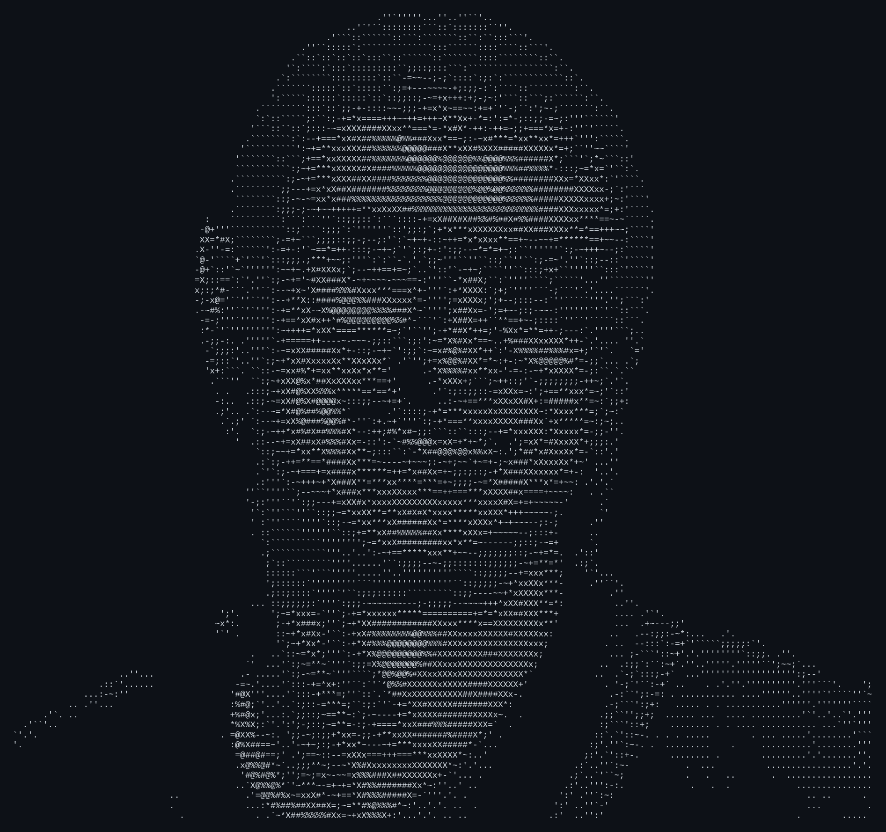

  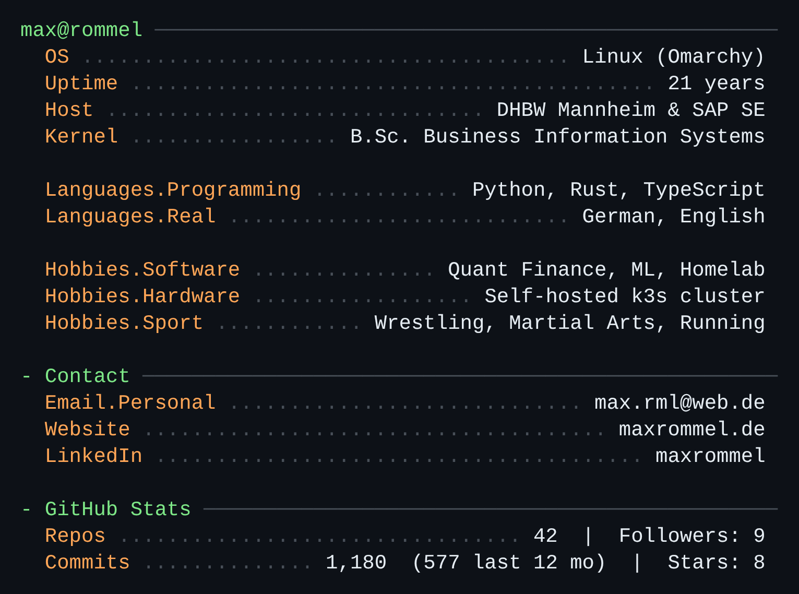

<h2 align="center">Skills</h2>

<b>Languages</b>  
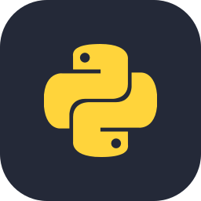
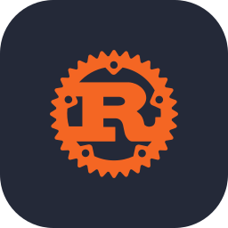
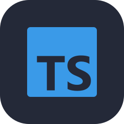
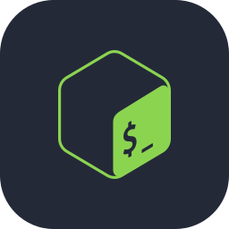

<b>ML, Quant &amp; Data Science</b>  
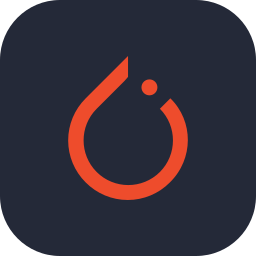
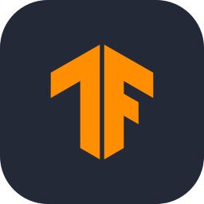
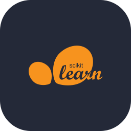

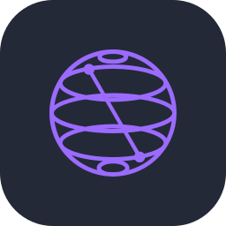
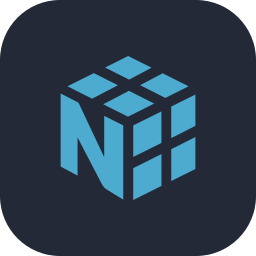
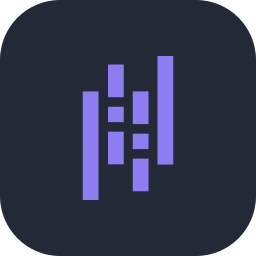
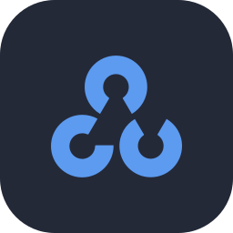

<b>Systems &amp; DevOps</b>  
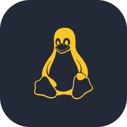
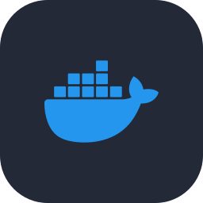
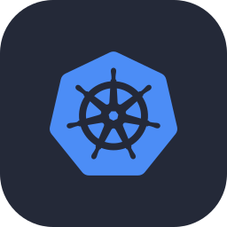

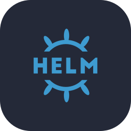
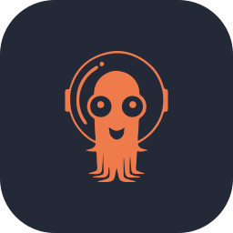
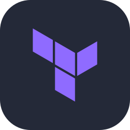
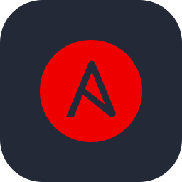
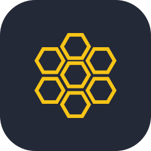

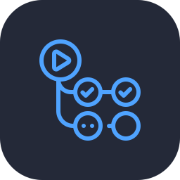
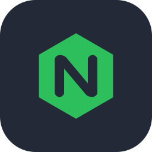
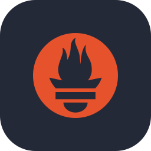
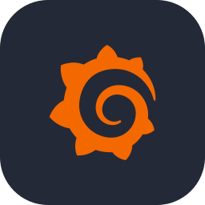

<b>Databases &amp; Messaging</b>  
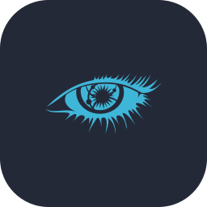
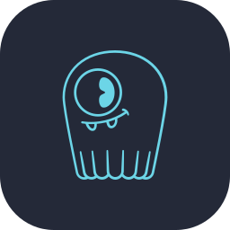
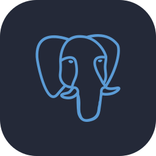
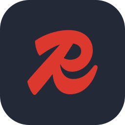
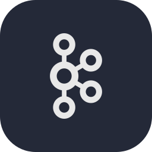
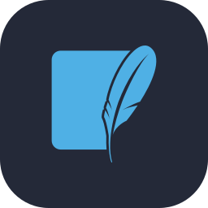

<h2 align="center">Latest</h2>

<h3 align="center">🔥 Blaze</h3>

<b>Fast, unified Rust tooling: lint, fmt, test, deny. One tool instead of four.</b>  
   

<h3 align="center">🦀 The cqlz family</h3>

<i>Rust tooling for Cassandra and ScyllaDB: catch CQL mistakes before runtime.</i>

<table>
<tr>
<td width="50%" valign="top">
<h4><a href="https://github.com/Max-imalgutaussehend/cqlz">cqlz</a></h4>
<b>Family hub</b> 
Website and cross-project benchmarks for the whole family.  

</td>
<td width="50%" valign="top">
<h4><a href="https://github.com/Max-imalgutaussehend/cqlc">cqlc</a></h4>
<b>Analyzer + codegen</b> 
Static CQL analyzer and Rust code generator, in the spirit of sqlc.  

</td>
</tr>
<tr>
<td width="50%" valign="top">
<h4><a href="https://github.com/Max-imalgutaussehend/cqlx">cqlx</a></h4>
<b>ORM</b> 
Typesafe, zero-overhead code-first ORM for ScyllaDB and Cassandra.  

</td>
<td width="50%" valign="top">
<h4><a href="https://github.com/Max-imalgutaussehend/cql-ai">cql-ai</a></h4>
<b>Anti-pattern detection</b> 
Tiny CQL-token Transformer that detects CQL anti-patterns in CI.  

</td>
</tr>
<tr>
<td width="50%" valign="top">
<h4><a href="https://github.com/Max-imalgutaussehend/cqlint">cqlint</a></h4>
<b>Linter + formatter</b> 
A very fast linter and formatter for CQL.  

</td>
<td width="50%" valign="top">
<h4><a href="https://github.com/Max-imalgutaussehend/cqlprof">cqlprof</a></h4>
<b>Profiler</b> 
EXPLAIN for CQL: tracing-based profiler for Cassandra and ScyllaDB.  

</td>
</tr>
<tr>
<td width="50%" valign="top">
<h4><a href="https://github.com/Max-imalgutaussehend/cql-migrate">cql-migrate</a></h4>
<b>Migrations</b> 
Checksummed, locked schema migrations with diff and drift detection.  

</td>
<td width="50%" valign="top">
<h4><a href="https://github.com/Max-imalgutaussehend/cqlz-lab">cqlz-lab</a></h4>
<b>Research (alpha)</b> 
RL schema synthesis and Markov workload models.  

</td>
</tr>
</table>
